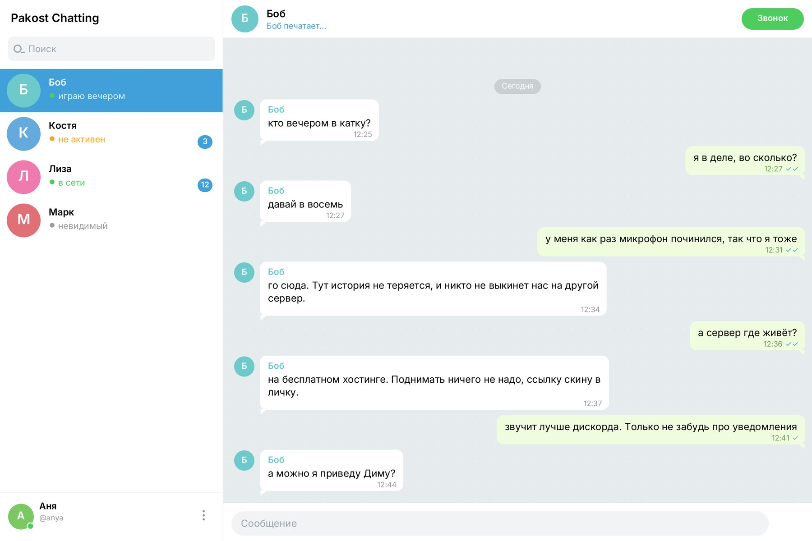
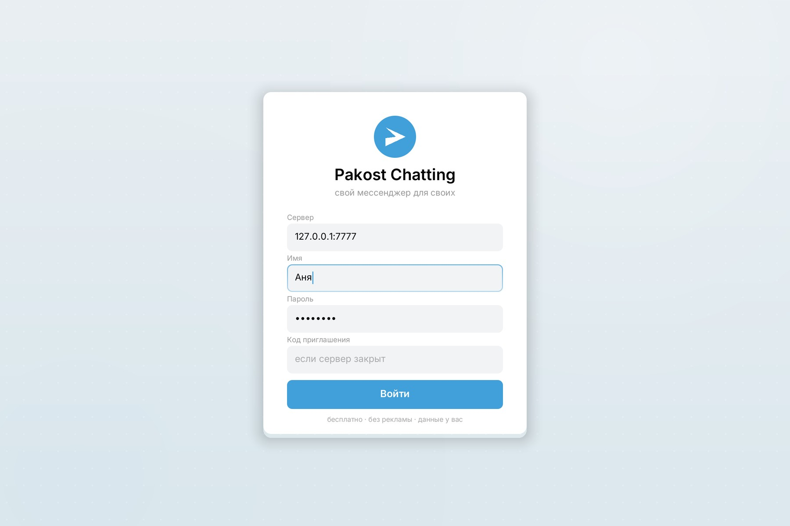
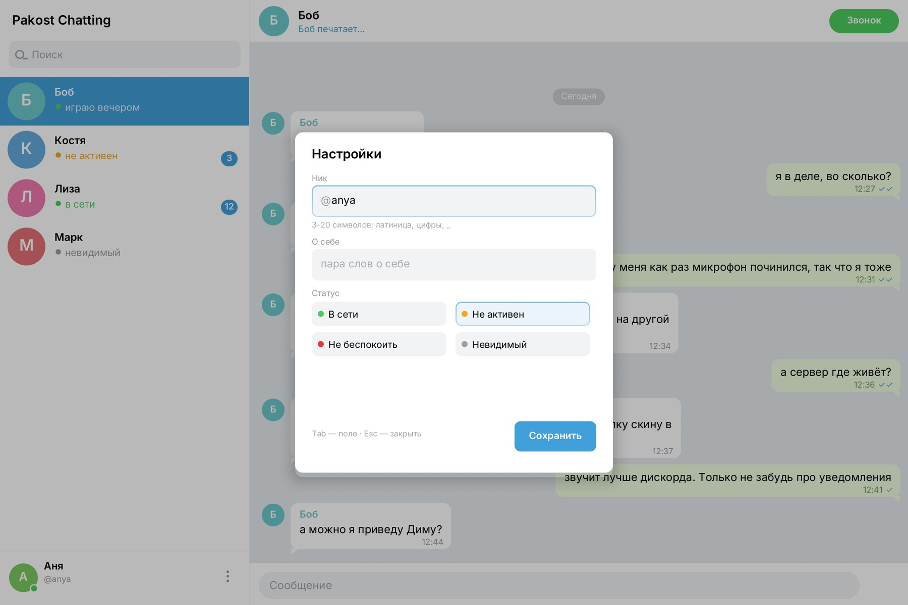
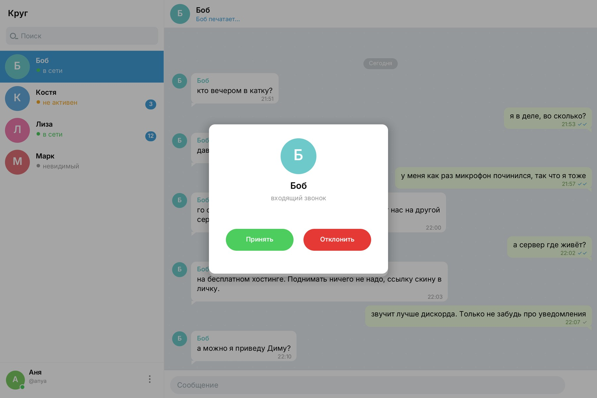

# Pakost Chatting

**Свой мессенджер для своих.** Нативный, на Rust, без Electron, Tauri и WebView.
Сервер — один бинарник, который можно поднять на бесплатном хостинге, а клиент —
окно или терминал на вашем компьютере. Интерфейс — в стилистике Telegram Desktop:
список чатов с поиском, облака сообщений, обои с узором и синий акцент. Всё
рисуется вручную, без браузера.










## Почему

- **Бесплатно.** Ни подписок, ни платных API, ни рекламы. Шрифты — OFL, хостинг —
  бесплатный тариф, всё остальное считается на вашем железе.
- **Без WebView.** Окно рисуется в память (`softbuffer`), текст — `fontdue`, ввод —
  `winit`. HTML, JS и браузерного движка внутри нет. Обои, облака сообщений и
  скругления рисуются вручную; шрифт — Inter.
- **Как у Discord, только свой.** Комнаты, история, кто в сети, «печатает…»,
  непрочитанные, переподключение. Сервер и история — у вас.
- **Легко портировать.** Ядро протокола (`krug-core`) не знает про ОС: `no_std` +
  `alloc`. Это задел под консоли и слабое железо — см. [PORTING.md](PORTING.md).

## Что уже умеет

- вход по нику и паролю, регистрация по коду приглашения;
- личные чаты: список людей, переписка, история на диске;
- отметки о прочтении: ✓ отправлено, ✓✓ прочитано;
- звонки 1:1 со звуком: микрофон, динамики, экран вызова, таймер;
- ники `@username`, «о себе», настройки профиля и статусы в духе Discord
  (в сети, не активен, не беспокоить, невидимый);
- «печатает…», непрочитанные, статус «в сети / не в сети»;
- сообщения с переносами, датами и группировкой по автору;
- два транспорта: чистый TCP и WebSocket (для бесплатных хостингов);
- автопереподключение с backoff, пинг/понг, защита от зависших соединений;
- ограничения размеров, rate limit, санитайзинг текста;
- нативное окно **и** консольный клиент на одном сетевом слое;
- интерфейс в стилистике Telegram: чаты, облака, обои, шрифт Inter.

## Чего пока нет

- звонки только 1:1, без видео и групповых созвонов;
- звук идёт сырым PCM 16 кГц (без Opus) — это ~32 КБ/с на направление;
- групповых чатов и каналов нет намеренно: только личные переписки;
- файлов, картинок, реакций, уведомлений;
- сквозного шифрования: `wss://` даёт TLS, чистый TCP — нет. Для друзей в
  локальной сети нормально, для интернета лучше `wss://` или свой VPN.

Это честный MVP, а не «Discord за вечер». Основа рабочая: два человека
переписываются, история переживает перезапуск сервера — это проверено тестами.

## Быстрый старт

Нужен [Rust](https://rustup.rs) 1.75+.

```bash
cd krug
cargo build --release
```

### 1. Сервер

```bash
./target/release/krug-server --invite свои
```

Или с WebSocket (для Render/Cloudflare):

```bash
./target/release/krug-server --invite свои --ws-addr 0.0.0.0:8080
```

Флаги: `--addr`, `--data`, `--name`, `--invite`, `--motd`, `--max-users`,
`--ws-addr`. Данные лежат в `./data`: `users.bin`, `rooms.tsv`, `messages/*.bin`.

### 2. Окно

```bash
./target/release/krug-gui
```

Введи адрес сервера, ник, пароль и код приглашения. Пароль запоминается
сервером в виде соли и хеша, а не в открытом виде.

Полезно:

```bash
./target/release/krug-gui --server wss://krug-xxxx.onrender.com --name Аня --invite свои
./target/release/krug-gui --demo        # окно с примером, без сервера
```

### 3. Терминал

```bash
./target/release/krug -s 127.0.0.1:7777 -n Аня -p 1234 -i свои
```

Команды: `/rooms`, `/chat Боб`, `/who`, `/older`, `/quit`.

## В интернет — бесплатно

### Вариант A. Render (без карты, но засыпает)

Пошагово: [deploy/RENDER.md](deploy/RENDER.md). Коротко: залей репозиторий на
GitHub, создай Blueprint из `render.yaml`, задай `KRUG_INVITE`, получи адрес
`https://krug-xxxx.onrender.com` и укажи его в клиенте как
`wss://krug-xxxx.onrender.com`.

Минусы честно: бесплатный сервис засыпает через 15 минут без запросов и теряет
диск при перезапуске.

### Вариант B. Oracle Cloud Always Free (24/7, нужна карта для проверки)

Пошагово: [deploy/ORACLE.md](deploy/ORACLE.md). Машина `VM.Standard.E2.1.Micro`
или ARM A1 бесплатна навсегда, не засыпает, данные на диске. Клиент
подключается по `IP:7777`.

### Вариант C. Свой ПК + туннель (работает сразу)

```bash
./scripts/dev.sh          # терминал 1
./scripts/tunnel.sh       # терминал 2, нужен cloudflared
```

Cloudflare выдаст `https://…`, клиенту указывай `wss://…`. Бесплатно и без
аккаунта, но компьютер должен быть включён, пока играете.

### Свой VPS

`Dockerfile` и `fly.toml` в корне. Любой VPS с Docker:

```bash
docker build -t krug .
docker run -d -p 7777:7777 -p 8080:8080 -v krug_data:/data \
  -e KRUG_INVITE='svoi-2026' krug
```

## Как устроено

```
        TCP 7777 / WS 8080
┌──────────────┐  ◀──────────────────▶  ┌────────────────┐
│ krug-gui     │                        │ krug-server    │
│ krug (CLI)   │                        │  личные чаты   │
└──────┬───────┘                        │  присутствие   │
       │ krug-client: сеть, состояние   │  история       │
       │ krug-core: протокол, no_std    └───────┬────────┘
       └────────────────────────────────────────┘
                                            data/*.bin
```

| Крейт | Что делает | Зависимости |
|---|---|---|
| `krug-core` | кадры, модель, SHA-256, `no_std + alloc` | нет |
| `krug-server` | TCP/WS, личные чаты, история, rate limit | `getrandom`, `tungstenite` |
| `krug-client` | соединение, переподключение, состояние | `tungstenite` (+rustls) |
| `krug-cli` | терминальный клиент | `chrono` |
| `krug-gui` | окно, свой рендер, PNG-скриншоты | `winit`, `softbuffer`, `fontdue` |

Кадр протокола: `u32` длина + `u8` операция + поля (little-endian, строки с
`u16` длиной). Операции: `Login`, `Join`, `SendMessage`, `History`, `Typing`,
`OpenDirect`, `Read`, `Ping` → `Welcome`, `Joined`, `Message`, `Presence`, `Typing`,
`ReadReceipt`, `Users`,
`History`, `Pong`, `Error`. Всё описано в `crates/krug-core/src/proto.rs`,
реализация не тянет serde.

**Где данные.** Только на вашем сервере: `users.bin` (ник, соль, хеш),
`rooms.tsv`, `messages/<id>.bin`. Никакой телеметрии и внешних сервисов.

## Безопасность

- пароль: соль 16 байт + SHA-256, 4096 итераций; сравнение за постоянное время;
- инвайт сравнивается так же, без утечки по времени;
- лимиты: 64 КБ кадр, 4 КБ сообщение, 48 байт ник, 64 чата;
- rate limit: 3 сообщения/сек (burst 6), «печатает» не чаще 1.5 с;
- управляющие символы вырезаются, переводы строк сохраняются.

Это дружеский сервер, а не банк: для публичного интернета ставьте его за
`wss://` (Render/Cloudflare) или в VPN. Шифрование канала — на транспорте.

## Тесты

```bash
cargo test
```

29 тестов. Покрыто: SHA-256 на известных векторах, кодирование/декодирование всех
операций, логин и инвайты, нумерация сообщений, сквозной сценарий «два клиента
переписываются», перезапуск сервера с сохранением истории, WebSocket и
health-check, отказ по неверному инвайту.

## Структура

```
krug/
├── crates/
│   ├── krug-core/      протокол, модель, SHA-256, кадры (no_std)
│   ├── krug-server/    сервер, личные чаты, хранилище
│   ├── krug-client/    сетевой слой TCP/WS, состояние
│   ├── krug-cli/       консольный клиент
│   └── krug-gui/       окно, рендер, скриншоты
├── assets/fonts/       Inter (OFL)
├── deploy/             Render, Oracle
├── scripts/            dev, build, tunnel
├── docs/               скриншоты
├── Dockerfile
└── render.yaml
```

## Что дальше (список фич)

- [x] звонки со звуком и микрофоном — **готово**;
- [x] голосовые сообщения — запись 1.4 с, отправка, проигрывание по клику;
- [ ] значки и эмодзи-статусы;
- [ ] стикеры и реакции;
- [ ] персонализация: аватары, цвет ника, обои чата;
- [ ] оформление: светлая/тёмная тема, акцентные цвета, размер текста.

## Лицензия

Код — MIT. Шрифт Inter — SIL Open Font License 1.1
(`assets/fonts/Inter-OFL.txt`).
